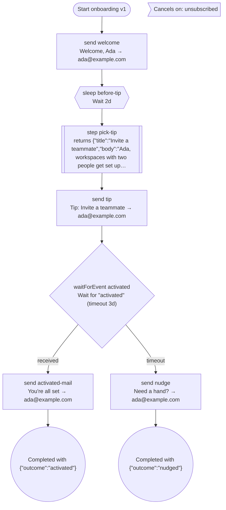

<Callout type="warn" title="Experimental">
The inspector ships with `@opencoredev/email-sdk/workflows`, which is new in 3.1. Its output format may change in a minor release.
</Callout>

A workflow is plain TypeScript, so its shape lives in the code: which emails go out, how long it sleeps, where it waits for an event, and what happens when the event never comes. `inspectWorkflow` turns that code into a graph without sending anything, and `describeRun` turns a stored run into a timeline. The viewer below draws both for the onboarding drip from [Email workflows](/docs/guides/email-workflows).

<WorkflowViewer />

**Definition** shows every path the workflow can take. Select a node on the canvas or in the steps list to see its details: the rendered email for a send, the duration for a sleep, the timeout for an event wait. **Sample run** replays a real engine run of the same workflow on a fake clock: Ada signs up, gets the tip on day 2, and activates on day 3. Each keyframe is the stored run at that moment, as `describeRun` reports it.

## Inspect a workflow in code

```ts title="scripts/inspect-onboarding.ts"
import { inspectWorkflow, toMermaid } from "@opencoredev/email-sdk/workflows";
import { onboarding } from "../src/workflows/onboarding";

const graph = await inspectWorkflow(onboarding, {
  input: { userId: "u_1", email: "ada@example.com", name: "Ada" },
  events: { activated: { plan: "pro" } },
  steps: { "pick-tip": { title: "Invite a teammate", body: "Ada, workspaces with two people get set up twice as fast." } },
});

console.log(toMermaid(graph));
```

`inspectWorkflow` parses `input` with the workflow's input schema, then calls `run` with a tracing `ctx`:

| Call | What the inspector does |
| --- | --- |
| `ctx.send` | Records the step name and the rendered email: from, to, cc, bcc, reply-to, subject, text, and HTML. Sends nothing. |
| `ctx.sleep`, `ctx.sleepUntil` | Records the delay and moves the path's clock forward. `sleepUntil` measures from `startedAt`, which defaults to 0. |
| `ctx.waitForEvent` | With a `timeout`, forks the path: `received` resolves with the sample payload from `events`, keyed by event name, and `timeout` resolves as timed out. Without one, only `received` exists. |
| `ctx.step` | Returns the mock from `steps`, keyed by step name, without calling the callback. Steps without a mock return `undefined` and show as `unknown`. |

The callback of `ctx.step` never runs, so a step can't send, wait, or touch your database during inspection. Code between `ctx` calls does run, so keep it free of side effects, as [replay](/docs/guides/email-workflows#how-replay-works) already requires.

Exploration is deterministic and capped. `maxPaths` (default 32) limits how many paths are explored, and each timed wait can double the count. `maxDepth` (default 100) cuts a path off after that many `ctx` calls, which stops an unbounded loop. When a cap is hit, `truncated` is `true` and a cut-off path ends in a `truncated` node. A path whose code throws ends in a `failed` node with the error. A failure on a `received` branch notes any event that had no sample payload, the usual cause.

The graph is plain JSON: `{ workflow, version, cancelOn, nodes, edges, paths, truncated, limits }`. Node ids are step names, prefixed with the branch choices that lead to them, so `activated:timeout/nudge` is the nudge on the timeout branch. `toMermaid(graph)` renders a flowchart and `formatWorkflowGraph(graph)` a plain-text outline.

## Inspect from the terminal

Agents without a browser get the same graph from the CLI. It imports the module and prints JSON, Mermaid, or text:

```bash
npx --package @opencoredev/email-sdk email-sdk workflows inspect ./src/workflows/onboarding.ts \
  --export onboarding \
  --input '{"userId":"u_1","email":"ada@example.com","name":"Ada"}' \
  --events '{"activated":{"plan":"pro"}}' \
  --steps @steps.json \
  --format mermaid
```

`--input`, `--events`, and `--steps` take inline JSON or `@path` to a file. See [`email-sdk workflows inspect`](/docs/reference/cli/workflows) for every option.

## Mermaid

This is the onboarding graph above, from `toMermaid`:

{/* generated:mermaid */}


## Describe a stored run

`describeRun(run)` reads a `WorkflowRun` from any store and lists each journaled step in the order it ran, with its kind, status, completion time, and a short result summary. A blocked run ends with the step it waits on, and `wait` carries the deadline. Failed runs carry `error`, and canceled runs carry `cancelReason`.

```ts
import { describeRun } from "@opencoredev/email-sdk/workflows";

const run = await workflows.get("onboarding:u_1");

if (run) console.log(describeRun(run));
```

On day 2 of the sample run, the onboarding run looks like this:

{/* generated:timeline */}
```json
{
  "runId": "onboarding:u_1",
  "workflow": "onboarding",
  "version": 1,
  "status": "waiting",
  "createdAt": "2026-03-02T09:00:00.000Z",
  "updatedAt": "2026-03-04T09:00:00.000Z",
  "entries": [
    {
      "status": "completed",
      "step": "welcome",
      "kind": "send",
      "completedAt": "2026-03-02T09:00:00.000Z",
      "summary": "Sent via resend (re_sample_1)"
    },
    {
      "status": "completed",
      "step": "before-tip",
      "kind": "sleep",
      "completedAt": "2026-03-04T09:00:00.000Z",
      "summary": "Waited"
    },
    {
      "status": "completed",
      "step": "pick-tip",
      "kind": "step",
      "completedAt": "2026-03-04T09:00:00.000Z",
      "summary": "Returned {\"title\":\"Invite a teammate\",\"body\":\"Ada, workspaces with two people get set up…"
    },
    {
      "status": "completed",
      "step": "tip",
      "kind": "send",
      "completedAt": "2026-03-04T09:00:00.000Z",
      "summary": "Sent via resend (re_sample_2)"
    },
    {
      "status": "waiting",
      "step": "activated",
      "kind": "event",
      "event": "activated",
      "until": "2026-03-07T09:00:00.000Z"
    }
  ],
  "subject": "ada@example.com",
  "wait": {
    "kind": "event",
    "step": "activated",
    "event": "activated",
    "until": "2026-03-07T09:00:00.000Z"
  }
}
```

## Read this page as an agent

Every docs page has a markdown twin. [`/docs/guides/view-email-workflows.md`](/docs/guides/view-email-workflows.md) carries the Mermaid above and the full JSON graph below, so an agent reading the docs sees the whole workflow without running anything.

<Accordions>
<Accordion title="Full inspectWorkflow JSON for the onboarding drip">

{/* generated:json */}
```json
{
  "workflow": "onboarding",
  "version": 1,
  "cancelOn": [
    "unsubscribed"
  ],
  "nodes": [
    {
      "id": "trigger",
      "kind": "trigger",
      "workflow": "onboarding",
      "version": 1,
      "input": {
        "userId": "u_1",
        "email": "ada@example.com",
        "name": "Ada"
      },
      "label": "Start onboarding v1",
      "offsetMs": 0
    },
    {
      "id": "welcome",
      "offsetMs": 0,
      "kind": "send",
      "step": "welcome",
      "email": {
        "from": "Acme <hello@acme.com>",
        "to": [
          "ada@example.com"
        ],
        "cc": [],
        "bcc": [],
        "replyTo": [],
        "subject": "Welcome, Ada",
        "text": "Your account is ready.\n\nReply to this email if anything looks off.",
        "html": "<div style=\"font-family:Helvetica,Arial,sans-serif;max-width:480px;margin:0 auto;padding:32px 24px;color:#14130f;line-height:1.55\"><p style=\"font-weight:700;font-size:15px;margin:0 0 24px\">Acme</p><h1 style=\"font-size:22px;line-height:1.25;margin:0 0 16px\">Welcome, Ada</h1><p style=\"font-size:15px;margin:0 0 14px\">Your account is ready.</p><p style=\"font-size:15px;margin:0 0 14px\">Reply to this email if anything looks off.</p><p style=\"font-size:12px;color:#6b6960;margin:28px 0 0\">You get this because you signed up for Acme. <a href=\"https://acme.example/unsubscribe\" style=\"color:#6b6960\">Unsubscribe</a></p></div>"
      },
      "label": "Welcome, Ada → ada@example.com"
    },
    {
      "id": "before-tip",
      "offsetMs": 0,
      "kind": "sleep",
      "step": "before-tip",
      "delay": {
        "kind": "duration",
        "ms": 172800000
      },
      "label": "Wait 2d"
    },
    {
      "id": "pick-tip",
      "offsetMs": 172800000,
      "kind": "step",
      "step": "pick-tip",
      "result": {
        "status": "mocked",
        "value": {
          "title": "Invite a teammate",
          "body": "Ada, workspaces with two people get set up twice as fast."
        }
      },
      "label": "returns {\"title\":\"Invite a teammate\",\"body\":\"Ada, workspaces with two people get set up…"
    },
    {
      "id": "tip",
      "offsetMs": 172800000,
      "kind": "send",
      "step": "tip",
      "email": {
        "from": "Acme <hello@acme.com>",
        "to": [
          "ada@example.com"
        ],
        "cc": [],
        "bcc": [],
        "replyTo": [],
        "subject": "Tip: Invite a teammate",
        "text": "Ada, workspaces with two people get set up twice as fast.",
        "html": "<div style=\"font-family:Helvetica,Arial,sans-serif;max-width:480px;margin:0 auto;padding:32px 24px;color:#14130f;line-height:1.55\"><p style=\"font-weight:700;font-size:15px;margin:0 0 24px\">Acme</p><h1 style=\"font-size:22px;line-height:1.25;margin:0 0 16px\">Tip: Invite a teammate</h1><p style=\"font-size:15px;margin:0 0 14px\">Ada, workspaces with two people get set up twice as fast.</p><p style=\"font-size:12px;color:#6b6960;margin:28px 0 0\">You get this because you signed up for Acme. <a href=\"https://acme.example/unsubscribe\" style=\"color:#6b6960\">Unsubscribe</a></p></div>"
      },
      "label": "Tip: Invite a teammate → ada@example.com"
    },
    {
      "id": "activated",
      "offsetMs": 172800000,
      "kind": "waitForEvent",
      "step": "activated",
      "event": "activated",
      "label": "Wait for \"activated\" (timeout 3d)",
      "timeoutMs": 259200000
    },
    {
      "id": "activated:received/activated-mail",
      "offsetMs": 172800000,
      "kind": "send",
      "step": "activated-mail",
      "email": {
        "from": "Acme <hello@acme.com>",
        "to": [
          "ada@example.com"
        ],
        "cc": [],
        "bcc": [],
        "replyTo": [],
        "subject": "You're all set",
        "text": "Enjoy the pro plan.",
        "html": "<div style=\"font-family:Helvetica,Arial,sans-serif;max-width:480px;margin:0 auto;padding:32px 24px;color:#14130f;line-height:1.55\"><p style=\"font-weight:700;font-size:15px;margin:0 0 24px\">Acme</p><h1 style=\"font-size:22px;line-height:1.25;margin:0 0 16px\">You're all set</h1><p style=\"font-size:15px;margin:0 0 14px\">Enjoy the pro plan.</p><p style=\"font-size:12px;color:#6b6960;margin:28px 0 0\">You get this because you signed up for Acme. <a href=\"https://acme.example/unsubscribe\" style=\"color:#6b6960\">Unsubscribe</a></p></div>"
      },
      "label": "You're all set → ada@example.com"
    },
    {
      "id": "activated:received/end",
      "kind": "end",
      "outcome": {
        "status": "completed",
        "output": {
          "outcome": "activated"
        }
      },
      "label": "Completed with {\"outcome\":\"activated\"}",
      "offsetMs": 172800000
    },
    {
      "id": "activated:timeout/nudge",
      "offsetMs": 432000000,
      "kind": "send",
      "step": "nudge",
      "email": {
        "from": "Acme <hello@acme.com>",
        "to": [
          "ada@example.com"
        ],
        "cc": [],
        "bcc": [],
        "replyTo": [],
        "subject": "Need a hand?",
        "text": "Reply to this email and we'll help you finish setup.",
        "html": "<div style=\"font-family:Helvetica,Arial,sans-serif;max-width:480px;margin:0 auto;padding:32px 24px;color:#14130f;line-height:1.55\"><p style=\"font-weight:700;font-size:15px;margin:0 0 24px\">Acme</p><h1 style=\"font-size:22px;line-height:1.25;margin:0 0 16px\">Need a hand?</h1><p style=\"font-size:15px;margin:0 0 14px\">Reply to this email and we'll help you finish setup.</p><p style=\"font-size:12px;color:#6b6960;margin:28px 0 0\">You get this because you signed up for Acme. <a href=\"https://acme.example/unsubscribe\" style=\"color:#6b6960\">Unsubscribe</a></p></div>"
      },
      "label": "Need a hand? → ada@example.com"
    },
    {
      "id": "activated:timeout/end",
      "kind": "end",
      "outcome": {
        "status": "completed",
        "output": {
          "outcome": "nudged"
        }
      },
      "label": "Completed with {\"outcome\":\"nudged\"}",
      "offsetMs": 432000000
    }
  ],
  "edges": [
    {
      "from": "trigger",
      "to": "welcome"
    },
    {
      "from": "welcome",
      "to": "before-tip"
    },
    {
      "from": "before-tip",
      "to": "pick-tip"
    },
    {
      "from": "pick-tip",
      "to": "tip"
    },
    {
      "from": "tip",
      "to": "activated"
    },
    {
      "from": "activated",
      "to": "activated:received/activated-mail",
      "branch": "received"
    },
    {
      "from": "activated:received/activated-mail",
      "to": "activated:received/end"
    },
    {
      "from": "activated",
      "to": "activated:timeout/nudge",
      "branch": "timeout"
    },
    {
      "from": "activated:timeout/nudge",
      "to": "activated:timeout/end"
    }
  ],
  "paths": [
    {
      "id": "path-1",
      "choices": [
        {
          "step": "activated",
          "branch": "received"
        }
      ],
      "nodes": [
        "trigger",
        "welcome",
        "before-tip",
        "pick-tip",
        "tip",
        "activated",
        "activated:received/activated-mail",
        "activated:received/end"
      ],
      "outcome": {
        "status": "completed",
        "output": {
          "outcome": "activated"
        }
      },
      "durationMs": 172800000
    },
    {
      "id": "path-2",
      "choices": [
        {
          "step": "activated",
          "branch": "timeout"
        }
      ],
      "nodes": [
        "trigger",
        "welcome",
        "before-tip",
        "pick-tip",
        "tip",
        "activated",
        "activated:timeout/nudge",
        "activated:timeout/end"
      ],
      "outcome": {
        "status": "completed",
        "output": {
          "outcome": "nudged"
        }
      },
      "durationMs": 432000000
    }
  ],
  "truncated": false,
  "limits": {
    "maxPaths": 32,
    "maxDepth": 100
  }
}
```

</Accordion>
</Accordions>
